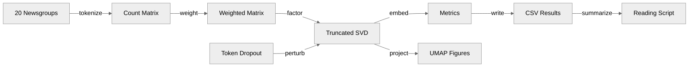
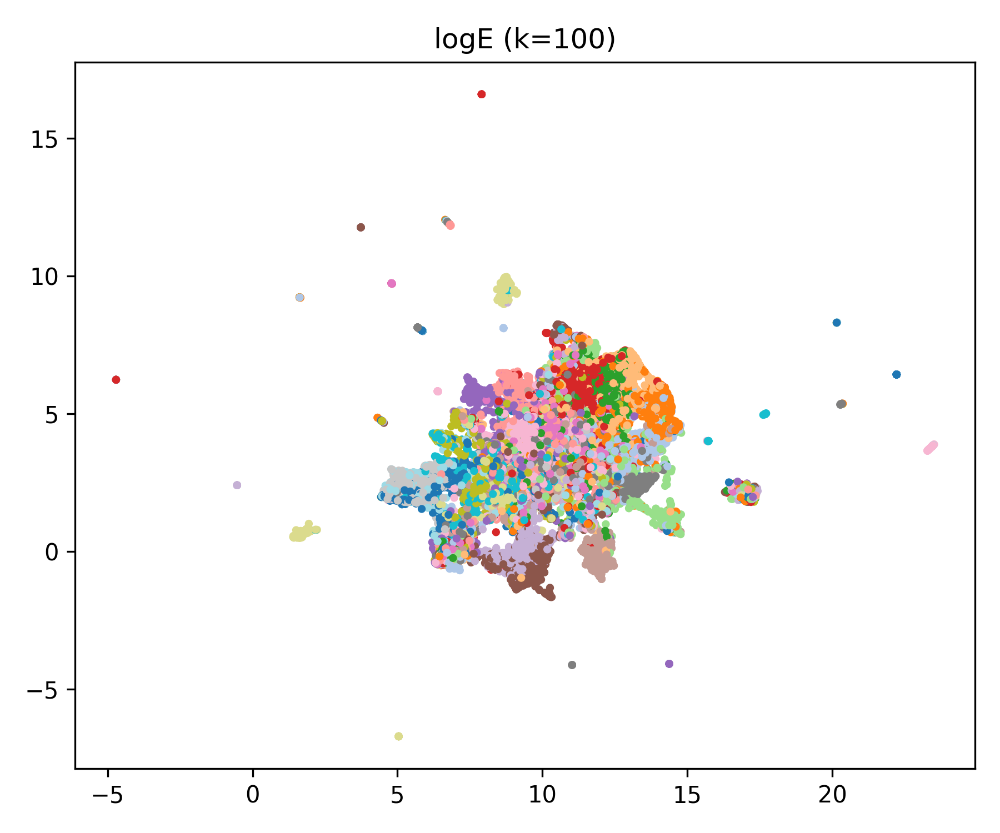
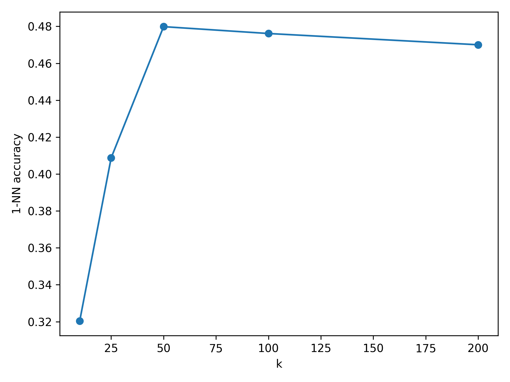
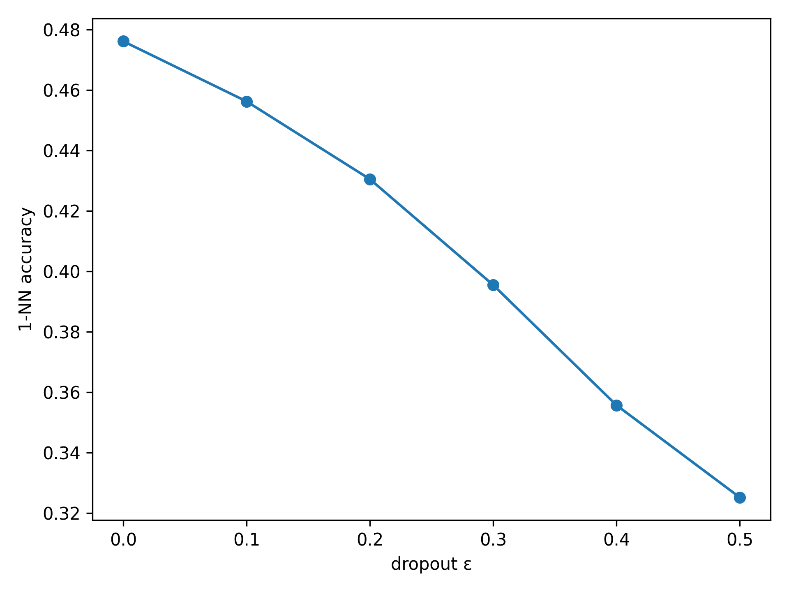

# LSA Optimization

**A reproducible study of term weighting, rank selection, and noise robustness in Latent Semantic Analysis.**

    

This project measures how three design choices in Latent Semantic Analysis (LSA) affect retrieval quality on the 20 Newsgroups corpus. Log-entropy weighting at 50 dimensions gives the best tested 1-nearest-neighbor accuracy (48.0%), and accuracy declines gradually rather than collapsing as tokens are removed.

## Overview

LSA represents documents by applying a truncated singular value decomposition (SVD) to a weighted term-document matrix. This repository runs a three-stage experiment on all 18,846 documents of 20 Newsgroups (20 labels, with headers, footers, and quoted replies removed) and writes every result to CSV files and figures with a single command.

- **Stage 1, term weighting:** compares raw counts, TF-IDF, and log-entropy at rank k = 100.
- **Stage 2, rank selection:** sweeps k over 10, 25, 50, 100, and 200 for the best weighting.
- **Stage 3, noise robustness:** randomly drops 0% to 50% of tokens and measures how accuracy degrades.
- **Reporting:** `reading.py` prints the headline numbers and a LaTeX-ready summary sentence from the CSVs.

## Business Case

### The Problem

Teams with large document collections (support tickets, legal discovery sets, research archives, internal wikis) need semantic search and automatic categorization. Transformer embeddings deliver this but cost GPU time and money at scale. LSA is cheap, explainable, and runs on a CPU, yet practitioners usually choose its weighting scheme and rank by habit rather than by evidence.

### Who It Serves

- **Data scientists:** choose a lightweight text representation with measured trade-offs instead of defaults.
- **Search and knowledge-management engineers:** size a semantic index by picking the smallest rank that keeps accuracy.
- **Educators and students:** study a complete, reproducible example of linear algebra applied to NLP.

### The Outcome

The study produces evidence-based defaults: use log-entropy weighting and about 50 dimensions. On a 20-class benchmark that configuration reaches 48.0% 1-NN accuracy with an embedding 57.2% smaller than the non-zero values of the sparse count matrix. Under token loss, log-entropy LSA at k = 100 degrades gradually rather than failing abruptly. Every number regenerates with one command.

## How It Works

The pipeline turns raw text into weighted matrices, factors them with truncated SVD, and scores each configuration.



1. **Load:** `src/data_loader.py` downloads 20 Newsgroups through scikit-learn and caches it in `data/`.
2. **Tokenize:** `src/preprocess.py` lowercases text, removes English stop words, and keeps terms found in at least 5 documents and at most 90% of documents.
3. **Weight:** `src/weighting.py` builds raw count, TF-IDF (L2-normalized), and log-entropy (row-normalized) matrices.
4. **Factor:** `src/lsa.py` fits a randomized `TruncatedSVD` with seed 42.
5. **Score:** `src/metrics.py` computes variance explained, relative reconstruction error, and 1-NN accuracy on a seeded 80/20 split.
6. **Perturb:** `src/noise.py` zeroes a random fraction of non-zero entries to simulate token loss.
7. **Orchestrate:** `src/experiments.py` runs the three stages, and `run_all.py` saves the CSVs, figures, and compression figure.
8. **Report:** `reading.py` selects the best weighting from `metrics_stage1.csv` and prints the headline numbers.

## Results

All values below are copied from the committed result files, rounded to one decimal place.

**Stage 1: term weighting at k = 100** (`metrics_stage1.csv`)

| Weighting | Variance explained | Reconstruction error | 1-NN accuracy |
|---|---|---|---|
| Raw counts | 99.5% | 7.1% | 30.7% |
| TF-IDF | 11.2% | 93.7% | 44.5% |
| Log-entropy | 10.4% | 94.1% | 47.6% |

**Stage 2: rank sweep with log-entropy** (`metrics_ranks.csv`)

| Rank k | 10 | 25 | 50 | 100 | 200 |
|---|---|---|---|---|---|
| 1-NN accuracy | 32.0% | 40.9% | 48.0% | 47.6% | 47.0% |

**Stage 3: token dropout with log-entropy at k = 100** (`metrics_noise.csv`)

| Dropout rate | 0% | 10% | 20% | 30% | 40% | 50% |
|---|---|---|---|---|---|---|
| 1-NN accuracy | 47.6% | 45.6% | 43.1% | 39.5% | 35.6% | 32.5% |

**Compression at k = 50** (`compression.csv`): 57.2%. This compares the float32 size of the 18,846 x 50 document embedding with the byte size of the int64 non-zero values array of the raw count matrix only; the sparse index arrays are excluded.

Key findings:

- **Variance explained is a misleading quality signal.** Raw counts explain 99.5% of variance yet give the lowest accuracy (30.7%), because a few high-frequency terms dominate the decomposition.
- **Log-entropy is the best weighting.** It beats TF-IDF by 3.1 percentage points of 1-NN accuracy at k = 100.
- **About 50 dimensions is enough.** Accuracy peaks at k = 50 (48.0%) and stays flat to slightly lower at k = 100 and k = 200.
- **Degradation under token loss is gradual.** Removing 30% of tokens costs 8.1 percentage points, with no sudden cliff.

The log-entropy embedding at k = 100 forms visible topic clusters in two dimensions, even though the 20 labels overlap heavily in the center.



Accuracy rises steeply up to k = 50 and then flattens, which supports a 50-dimensional index.



Accuracy falls steadily as the token dropout rate increases from 0 to 0.5, with no abrupt collapse.



## Tech Stack

| Layer | Technology | Purpose |
|---|---|---|
| Data | scikit-learn `fetch_20newsgroups` | Downloads and caches the 20 Newsgroups corpus |
| Data | pandas | Holds the corpus and writes result CSVs |
| Model | scikit-learn `CountVectorizer`, `TfidfTransformer` | Bag-of-words construction and TF-IDF weighting |
| Model | NumPy and SciPy sparse matrices | Log-entropy weighting and token dropout |
| Model | scikit-learn `TruncatedSVD`, `KNeighborsClassifier` | LSA factorization and 1-NN evaluation |
| Tooling | UMAP and Matplotlib | 2-D projections and result plots |

## Getting Started

### Prerequisites

- Python 3.8 or later.
- About 14 MB of network download on the first run (the 20 Newsgroups archive).
- More than 8 GB of RAM for the full pipeline. The reconstruction error metric builds dense 18,846 x 24,392 matrices.

### Installation

1. Clone the repository.

   ```bash
   git clone https://github.com/risingOnIP/LSA-Optimization.git
   cd LSA-Optimization
   ```

2. Create a virtual environment and install the dependencies.

   ```bash
   python -m venv .venv
   source .venv/bin/activate
   pip install -r requirements.txt
   ```

### Usage

Run the full experiment from the repository root.

```bash
python run_all.py
```

The script downloads the corpus into `data/`, runs all three stages, and overwrites `metrics_stage1.csv`, `metrics_ranks.csv`, `metrics_noise.csv`, `compression.csv`, and the PNG files in `figs/`. UMAP projections make the run take several minutes.

Print the headline numbers and a LaTeX-ready summary sentence.

```bash
python reading.py
```

To change the experiment grid, edit `ks` (ranks) or `eps_list` (dropout rates) in `run_all.py`. To add a weighting scheme, implement it in `src/weighting.py` and register it in `src/experiments.py` and `run_all.py`.

## Project Structure

```text
LSA-Optimization/
├── src/
│   ├── data_loader.py     # download and load 20 Newsgroups
│   ├── preprocess.py      # tokenizer and count matrix
│   ├── weighting.py       # raw, TF-IDF, and log-entropy weighting
│   ├── lsa.py             # truncated SVD wrapper
│   ├── metrics.py         # variance, reconstruction error, 1-NN accuracy
│   ├── noise.py           # token dropout
│   ├── viz.py             # UMAP scatter plots
│   └── experiments.py     # stage 1 to 3 experiment runners
├── figs/                  # result figures
├── run_all.py             # runs every stage, writes outputs
├── reading.py             # prints headline numbers for write-ups
├── metrics_stage1.csv     # weighting comparison at k = 100
├── metrics_ranks.csv      # rank sweep results
├── metrics_noise.csv      # dropout robustness results
├── compression.csv        # embedding size reduction at k = 50
├── requirements.txt
└── LICENSE
```

## Scope and Limitations

- Each configuration is evaluated on one seeded 80/20 split with one SVD seed, so the results carry no confidence intervals.
- Quality is measured with 1-NN classification accuracy only; retrieval metrics such as precision at k are not computed.
- The compression figure excludes the sparse index arrays of the count matrix, so it understates the savings against a full sparse representation.
- Dependencies in `requirements.txt` are minimum versions, not exact pins, so a future library release could shift results slightly.
- Result CSVs are written to the repository root, where `reading.py` expects them.
- The reconstruction error computation densifies the full matrix, which sets the memory requirement above.

## Roadmap

- [ ] Add repeated splits and seeds and report the mean and spread of each metric.
- [ ] Add retrieval metrics (precision at k, mean average precision) alongside 1-NN accuracy.
- [ ] Compute reconstruction error without densifying the matrix to reduce peak memory.
- [ ] Pin exact dependency versions for byte-identical reproduction.
- [ ] Move result CSVs into a dedicated `results/` directory.

## Acknowledgments

- The [20 Newsgroups dataset](http://qwone.com/~jason/20Newsgroups/), collected by Ken Lang, is downloaded at run time through [scikit-learn](https://scikit-learn.org/stable/datasets/real_world.html#newsgroups-dataset) and is not redistributed in this repository.
- [UMAP](https://umap-learn.readthedocs.io/) by Leland McInnes, John Healy, and James Melville provides the 2-D projections.

## License

Released under the [MIT License](LICENSE).

## Author

Developed by [Karthik Kaligotla](https://github.com/risingOnIP), named inventor on U.S. Patents [12,445,488 B2](https://patents.google.com/patent/US12445488B2/) and [12,598,158 B2](https://patents.google.com/patent/US12598158B2/).
